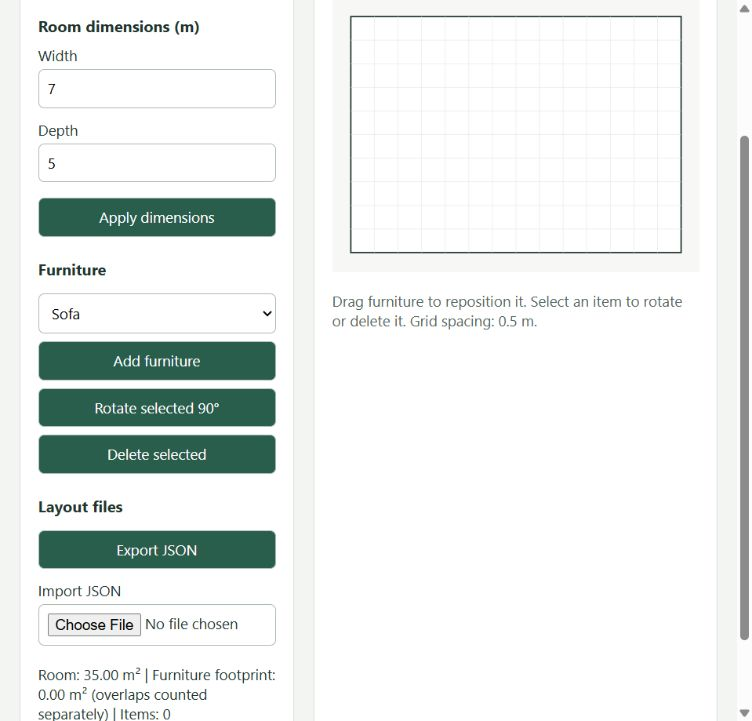

# SpacePlan
A dependency-free browser-based concept furniture layout planner. Open index.html through a local web server (for example `python -m http.server 8000`) or deploy to GitHub Pages.

[Open the live demo](https://ameer93emad-dev.github.io/architecture-space-planner/)

## Try the demo

Set the room to 7 m wide and 5 m deep, then add a sofa. The summary shows 35.00 m² of room area and 1.98 m² of furniture footprint. Rotate the sofa to compare arrangements. The screenshot uses this example layout.

## Features
Rectangular rooms, half-meter grid, five furniture types, pointer dragging, rotation, deletion, room and furniture footprint calculations, JSON import/export.

## Limitations
Concept planning only: no collision detection, code compliance, wall openings, CAD export or AI optimization. Furniture footprint totals count overlaps separately. No data is transmitted by the application.

## Contributing
Bug reports and pull requests are welcome. Use synthetic layouts and do not include confidential client drawings.

MIT license.
